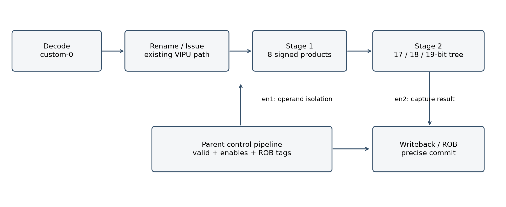
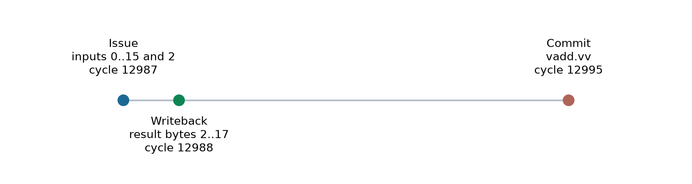
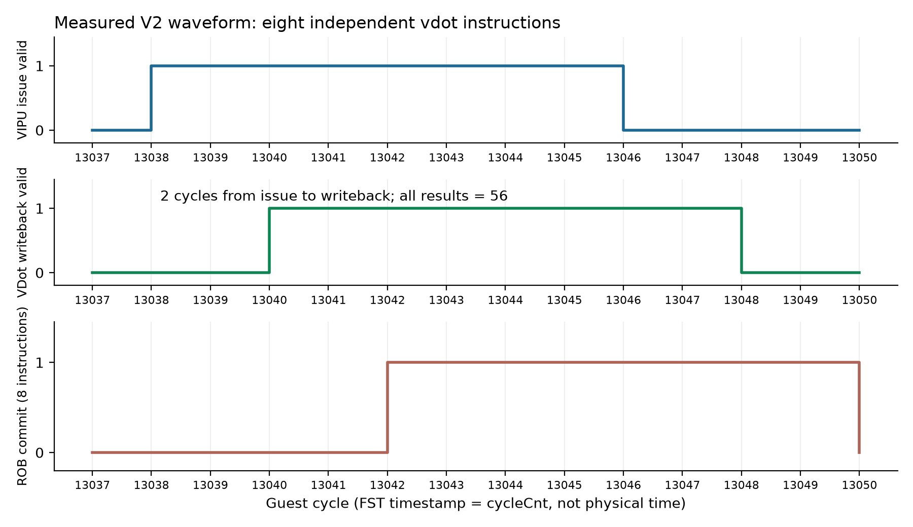
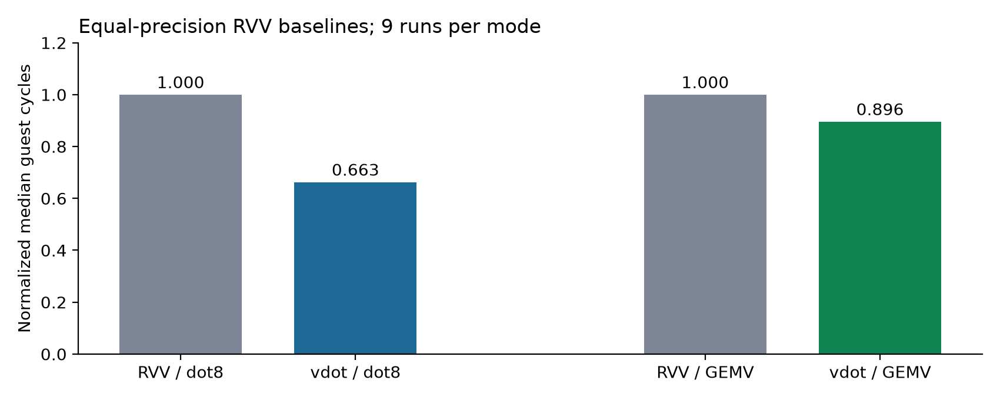

2026 CIE 香山社区 RISC-V 应用创新赛道
技术报告 · 2026 年 10 月 8 日

团队：________________    作者：________________
学校 / 单位：________________    指导教师：________________

## 摘要

本项目在香山昆明湖 V2 最小配置的已有向量执行通路中集成自定义 vdot.vv 指令，完成编码识别、调度、两级乘加数据通路、结果写回、NEMU 参考执行以及整机差分验证。单条指令计算 8 对有符号 int8 输入的精确点积，结果写入目标向量寄存器低 32 位，其余 96 位清零。

实现采用 8 路并行乘法与逐级扩位的平衡加法树，并以使能隔离无效操作数。真实整机波形测得执行单元延迟 2 周期，独立指令发射间隔 1 周期；依赖链实测发射间隔为 7 周期。在相同精度的标准 RVV 基线下，单次 8 元素可调用内核中位加速比为 1.509 倍，256 元素 GEMV 行内核中位加速比为 1.116 倍。

| 关键结果 | 本次实测 |
| --- | --- |
| 整机差分 | 1,025 组功能数据；4,096 组寄存器位置；11 类异常配置；512 组分支恢复 |
| 吞吐与依赖 | 8 条独立指令、16 条连续数据依赖指令全部通过 |
| 模块正确性 | Yosys SAT 等价；65,536 单通道穷举；4,096 随机向量；4,096 流水周期 |
| 结果范围 | 所有测量来自锁定版本和 KunminghuV2MinimalConfig；不等同于完整配置或真实芯片指标 |

公开规格对 vd[0] 的结果位宽存在歧义。本作品采用完整 32 位结果这一明确的工程约定，尚未获得组委会专项确认。作品完整性应结合本报告的验证范围和提交清单审阅。

## 1 赛题要求与指令规格

赛题要求基于香山昆明湖 V2，完成自定义向量点积指令设计，复用已有向量寄存器及相关模块，并通过环境验证、指令实现和协同仿真三个阶段形成可复现证据。官网给出 SEW=8、VLEN=128；配图以 8 个元素相乘累加，结果写入 vd[0]，其他通道清零。[1][2]

| 项目约定 | 具体定义 |
| --- | --- |
| 输入 | vs1、vs2 各自低 8 字节解释为有符号 int8；高 8 字节不参与运算 |
| 输出 | vd[31:0] 为精确点积的二进制补码；vd[127:32]=0 |
| 合法配置 | VLEN=128，SEW=8，LMUL=1，VL=8，vm=1，vstart=0，向量状态已启用 |
| 别名与寄存器 | 允许 vd=vs1、vd=vs2；支持 v0 与 v31 等边界位置 |
| 非法配置 | 产生 illegal-instruction 异常；不得提交目的寄存器写入 |

### 编码与精度

| 字段 | 位域 | 本项目值 |
| --- | --- | --- |
| funct7 | 31:25 | 0000001（包含 vm=1） |
| vs2 / vs1 | 24:20 / 19:15 | 任意向量寄存器编号 |
| funct3 / vd / opcode | 14:12 / 11:7 / 6:0 | 000 / 目标寄存器 / 0001011（custom-0） |

示例：vdot.vv v10,v8,v9 的编码为 0x0294050b。工具链通过 .word 发出自定义指令，无需修改汇编器。该编码属于本项目分配，未宣称是官方统一编码。

单项乘积范围为 [-16,256,16,384]；8 项总和范围为 [-130,048,131,072]。18 位有符号数的最大正值仅为 131,071，因此最终和至少需要 19 位。完整结果扩展至 32 位，避免 int8 乘法或归约先溢出。

结果位宽、固定 VL 与 LMUL 限制均写入规格和模型；后续若官方澄清不同语义，应同步修改 RTL、NEMU、软件参考、测试和报告，重新运行全部回归。

## 2 数据通路与控制集成



第一级并行计算 8 个 signed 8×8 乘积，并在 en1 有效时保存 128 位乘积向量。第二级使用 4 个 17 位、2 个 18 位和 1 个 19 位加法结果组成平衡树，在 en2 有效时锁存输出。符号扩展仅作用于低 32 位；整个目标寄存器其余位显式清零。

VDotPipe 仅承担数据计算。父级 VIPU 沿用已有 issue、向量寄存器读取、ROB 标记、异常和写回控制。en1=regEnable(1)∧dotIn，en2=regEnable(2)∧上一阶段为 vdot；输出选择由同行控制字段确定，不依赖无效周期的旧数据。

标准向量 ALU 仍服务原有指令。vdot 的结果绕过通用尾部/掩码合并，因为项目语义要求写完整 128 位结果；其合法性检查则显式限制 VL、SEW、LMUL、vstart 和 vm，避免与通用 RVV 尾部策略混用。

单元本身没有为结果寄存器增加复位：有效性由父流水线管理。验证不会将启动后尚未经历两次有效捕获的寄存器内容当作有效结果。分支恢复测试检查架构状态；它不构成对全部乱序冲刷时序的形式证明。

## 3 软件与 NEMU 协同实现

| 修改位置 | 作用 |
| --- | --- |
| XSDot8.scala、VecDecoder.scala | 定义 custom-0 位模式与内部 fuOpType=0xfe；进入已有 VIPU 路由 |
| RiscvInst.scala、VecExceptionGen.scala | 识别向量算术类别，检查静态向量配置 |
| VIPU.scala、VDotBlackBox.scala | 两级使能、BlackBox 资源、完整结果及运行期非法配置 |
| VDotPipe.sv | 并行乘法、平衡树、使能捕获与操作数隔离 |
| NEMU decode.c / isa-all-instr.h / vcompute.h | 解析自定义编码，检查配置，读取完整源后写目标 |
| software/kernels.S / regression_asm.S | 可调用内核、精度一致基线、异常、寄存器、依赖链及分块 GEMV |

NEMU 对两个源寄存器先读后写，避免目标与任一源重叠时破坏输入。软件独立标量参考使用 int32 计算 8 元素结果，GEMV 行累加使用 int64；因此验证包含与硬件和 NEMU 实现路径不同的数值参照。

### 通过测试定位并解决的集成问题

- BlackBox 文件名与模块名统一为 VDotPipe，确保干净生成 RTL 后 Verilator 能解析资源。

- 测试平台使用与仿真器一致的三条 boot ROM 指令；专用 NEMU defconfig 保存该差异，避免首条提交前失配。

- AM 程序显式开启 VS；异常测试初始化 mnstatus.NMIE 并清除 mstatus.MDT，建立普通 M 模式陷阱环境。

- 运行期 VL 错误在香山执行端产生，mtval 为 0；NEMU 对该类错误采用相同平台约定。静态非法配置仍返回原指令编码。CSR 对比始终启用，没有用跳过比较掩盖问题。[4]

- KunminghuV2MinimalConfig 的 OpenLLC 继承了不足的默认地址宽度，导致负位域生成错误；补丁让其采用 SoC 的 48 位 PAddrBits。

## 4 实验环境与配置选择

| 项目 | 本次环境 |
| --- | --- |
| 主机与系统 | 16 GB 内存 Windows 主机；WSL2 Ubuntu 22.04 |
| WSL 资源 | 内存上限 10 GB；D 盘 24 GB swap |
| 生成与仿真 | GraalVM JDK 21；Mill 0.12.3；Verilator 5.052；单仿真线程 |
| 软件编译 | riscv64-linux-gnu GCC 11；rv64gcv / lp64d；nexus-am |
| 目标配置 | KunminghuV2MinimalConfig；CHI；VLEN=128；LLC 地址宽度兼容修复 |
| 源码固定 | 香山 16ae9ddcda54fc9a2fddffad73174cf793ac7814；NEMU a48a11f208ff81ad765591d83271d1b339fb3861 |

配置决定生成怎样规模的处理器，例如 ROB、队列、缓存和互连资源。它在 Scala/Chisel 生成 RTL 时起作用，而不是仿真运行时才切换的选项。更换 CONFIG 后必须重新生成并编译 emu。

MinimalConfig 用于降低本机资源压力；KunminghuV2MinimalConfig 在该基础上选择 V2 相关的 CHI 和缓存参数。公开赛题指定昆明湖 V2，但本次查阅页面没有明确给出必须使用的 Config 类名或唯一提交。本报告准确标注实际配置，完整 KunminghuV2Config 的构建与性能不在本次已验证范围。

```bash
export JAVA_HOME=/opt/graalvm-jdk-21
export PATH="$JAVA_HOME/bin:/usr/local/llvm/bin:$PATH"
make emu CONFIG=KunminghuV2MinimalConfig \
  JVM_XMX=12G EMU_THREADS=1 EMU_TRACE=fst -j4
```

JVM_XMX=12G 是堆上限，允许部分内存页进入 swap，并非物理内存大小。-j4 限制编译并发；EMU_THREADS=1 限制仿真器线程。较大 swap 解决了本次构建容量问题，但会增加编译时间。报告中的周期是目标处理器周期，不能用主机运行耗时替代。

## 5 验证矩阵与覆盖范围

| 层级 | 用例与判据 | 结果 |
| --- | --- | --- |
| 独立参考 | 编码往返、必需数据、非法配置及高半部分忽略 | 通过 |
| 组合 RTL | Yosys SAT：平衡树与独立串行累加结果恒等 | 通过 |
| 展开网表 | 25 定向；65,536 单通道穷举；4,096 随机向量；4,096 流水周期 | 通过 |
| 实际 RTL 仿真 | Icarus：4,096 随机 en1/en2；输出保持与延迟；隔离活动量 | 通过 |
| NEMU 函数 | 32,768 寄存器组合及 5 类非法配置，实际函数提取 | 通过 |
| V2 数值回归 | 1,025 组；标准 RVV/标量/vdot；目标与源别名；完整 128 位结果 | GOOD TRAP |
| V2 寄存器回归 | 128 组随机 × 32 目标位置，共 4,096 组，含 v0/v31 | GOOD TRAP |
| V2 异常回归 | 11 类；mcause=2；准确异常次数；目标字节不变 | GOOD TRAP |
| V2 分支恢复 | 512 组随机分支；被跳过路径与已执行路径的架构结果 | GOOD TRAP |
| V2 流水线 | 8 条独立指令；16 条依赖链；结果与波形逐项核对 | GOOD TRAP |
| GEMV | 16 种长度，覆盖 0、8/64 边界、非整块尾部与 263 元素 | GOOD TRAP |

11 类异常为 SEW=16、LMUL=2、LMUL=1/2、VL=0/1/7/16、vstart=1、vill、vm=0 和 VS 关闭。用例通过真实异常处理程序返回；检查一次陷阱、原因码以及原目标寄存器 16 个字节保持不变。

证据分层保存。NEMU 函数测试不能替代整机差分；两态网表测试不能替代四态复位分析；分支恢复程序不能证明任意冲刷窗口；SAT 组合等价不覆盖整颗乱序处理器。测试源、日志、退出码、FST、提取 VCD 和校验和均随包提供。

## 6 向量加法波形分析



测试将 v8 的 16 个字节设置为 0 至 15，将 v9 全部设置为 2，在 e8、m1、VL=16 下执行 vadd.vv v10,v8,v9。随后存回 16 字节，并逐项检查结果为 2 至 17，差分运行输出 VECTOR_ADD bytes=16 PASS。

| 事件 | 周期 | 直接证据 |
| --- | --- | --- |
| 发射 | 12987 | 实际活动实例 exus_2.VialuFix；io_in_valid=1；fuOpType=0x40 |
| 结果有效 | 12988 | io_out_valid=1；结果 0x11100f0e0d0c0b0a0908070605040302 |
| 架构提交 | 12995 | ROB commitValid 与 debug_instr 同时有效，匹配 vadd 编码 |

输入十六进制按小端字节解释；右侧最低字节是元素 0。该样例的执行单元输入到输出为 1 周期，发射到提交为 8 周期。提交较晚反映乱序机器的完成和退休是不同事件；不能把所有时间差归因于加法逻辑。

波形路径保存完整层次，另附 selected-signals.json，将小 VCD 中的别名映射到原始 FST 信号。分析程序同时扫描两条 VialuFix 通路，以实际 valid 为准，避免观察未接收该指令的执行端口。

原始 FST 使用 emu 默认 --dump-wave 模式。源码将 DiffTrapEvent.cycleCnt 作为时间戳，每个目标周期采样一次；图中的横轴因此是 guest cycle，不能根据 VCD 的显示单位推断芯片频率。

## 7 vdot 延迟、吞吐与依赖链



输入低 8 字节为 [0,1,2,3,4,5,6,7] 与 [2,2,2,2,2,2,2,2]，结果应为 56。连续 8 条独立 vdot 在周期 13038 至 13045 发射，13040 至 13047 产生有效结果，13042 至 13049 依次提交。每条写回的 ROB 标记可与提交位置核对。

| 指标 | 实测值 | 解释 |
| --- | --- | --- |
| FU 输入到输出 | 2 周期 | 24 条连续/依赖实验均一致；另有 8 个样例一致 |
| 独立发射间隔 | 1 周期 | 7 个相邻间隔均为 1；理想数据就绪条件 |
| 依赖链发射间隔 | 7 周期 | 15 个相邻间隔均为 7；包含真实调度、写回与唤醒路径 |
| 依赖链数值 | 252 | 每步将上一条低 32 位按字节重新解释，16 次结果匹配独立标量递推 |

执行单元的两级流水并不保证整个相关指令链每两周期发射一次。观测到的 7 周期是本配置上的端到端相关路径效果。其精确分解需进一步对唤醒/旁路链路逐级观测，本报告不将其未经证明地归因于某一个队列或寄存器。

8 路分块软件将独立点积交错排列，使其优先使用吞吐能力，而非把同一个结果寄存器串成依赖链。该测量同时说明：仅优化乘法和加法树，不能自动得到相同比例的应用加速。

## 8 性能实验与公平基线



| 工作负载 | RVV 中位周期 | vdot 中位周期 | 加速比 |
| --- | --- | --- | --- |
| 8 元素可调用内核 | 28.473 | 18.871 | 1.509× |
| 256 元素 GEMV 行 | 622.750 | 557.906 | 1.116× |

8 元素基线采用 e8,mf2 的 vwmul 得到 16 位乘积，再用 e16 的 vwredsum 得到完整 32 位结果。若使用 e8 的 vmul+vredsum，乘法和加法可能先溢出，不能与本项目比较。本版同时删除了基线中不必要的目标清零。

GEMV 按 64 元素分块：两种实现均一次准备 8 组输入。vdot 写入 8 个独立结果寄存器后统一抽取；RVV 先生成 8 组宽乘积，再批量宽归约和抽取。余下的 8 元素块及标量尾部均通过边界测试，避免以较弱基线夸大收益。

单内核测试每模式预热 16 次，每轮 256 次，重复 9 轮；GEMV 每模式预热 8 次，每轮 32 行，每行 256 元素，重复 9 轮。测量区间不包含打印，包含调用、循环、访存和校验和累积。GEMV 周期下降 10.41%。

所有数据是本配置热数据微基准，未运行完整大语言模型、冷缓存/多核场景或物理芯片。结论只能表述为本内核和测量条件下的加速，不能直接换算为模型 tokens/s 或芯片能效提升。

## 9 统计、结构对照与设计取舍

| 测量对象 | 最小 | 最大 | 均值 | 标准差 |
| --- | --- | --- | --- | --- |
| dot8 / baseline | 28.469 | 28.629 | 28.498 | 0.052 |
| dot8 / vdot | 18.805 | 19.090 | 18.894 | 0.090 |
| GEMV / rvv | 622.719 | 623.375 | 622.847 | 0.208 |
| GEMV / vdot | 557.875 | 558.188 | 557.934 | 0.091 |

单位为周期/调用或周期/行。标准差按 9 轮总体计算；中位数用于主要比值。逐轮原始周期及指令计数见 results/performance-summary.json 和 GEMVBENCH 日志，任何统计值均可从原始输出重算。

### 位宽和树形结构

平衡树各加法输出位宽合计为 4×17+2×18+19=123；独立串行 32 位累加网表保留 7 个 32 位加法输出，合计 224。该结构代理指标下降 45.09%，体现对数值范围的利用。它不是门面积，也不包含乘法器、寄存器和控制开销。

### 操作数隔离实验

对同一组 4,096 次输入刺激，活动率 50%，每 16 周期开/关一组。隔离版本的乘积输出共翻转 135,712 位，未隔离版本 256,397 位，减少 47.07%。活动周期结果一致，空闲周期隔离输出为 0。统计只测乘积输出位翻转，不是电路内部节点总活动量或实测功耗。

### 后续优化方向

优先研究依赖链中的 7 周期相关路径和现有 VIPU 的资源冲突；再比较更大的软件分块、缓存行为与真实量化 GEMV。若扩展支持不同 VL 或元素宽度，必须同时完善尾部、掩码、结果宽度和异常约定。物理 PPA 优化应在统一工艺库、时钟约束与综合流程下评估。

## 10 赛道证据与提交状态

| 公开评分项 | 本作品的证据入口 |
| --- | --- |
| 完整性 60 分 | 环境、设计、协同仿真三阶段；报告、RTL/NEMU 补丁、软件、日志、波形与视频 |
| 可行性 20 分 | 复用向量通路；干净 RTL 生成；严格整机差分；正确精度的 RVV 比较 |
| 探索能力 10 分 | 区分执行/写回/提交；测量 2/1/7 周期；定位启动与 mtval 约定 |
| 创新性 10 分 | 精确扩位树、操作数隔离、64 元素分块、结构对照与跨层证据 |

表中为公开评分项与材料的对应，不是得分预测。最终评分由评审根据技术质量、语义合规、材料和答辩确定。

| 提交材料 | 状态与位置 |
| --- | --- |
| 源代码与设计 | integration、rtl、software、model、tests、tools |
| 正式报告与说明 | docs 中的 Word 与 Markdown；项目说明独立提供 |
| 日志、波形及录像 | results 与 videos；真实终端时序保存在 .cast |
| 团队和作者信息 | 留空待填；不生成虚构身份 |
| 公有仓库与官方加密 PR | 本地包已准备，尚未向 GitHub 或官网提交 |
| 现场答辩 | 参赛者需熟悉实现、数据和限制；材料不代替本人答辩 |

演示视频采用真实终端执行时序及实测图表回放；不是首次安装桌面的历史录屏。若评委要求逐步安装操作录像，应使用环境文档在新环境复现并录制。原始 FST 较大，公开 GitHub 仓库应使用 Git LFS 或 Release 附件管理，并在 README 中提供稳定入口。

提交前应填写身份和仓库信息、确认官网最新语义及验收要求、检查公开仓库内容和辅助工具披露，再按官方流程加密提交信息。当前不勾选“已完成官方递交”。完整大配置验证、物理 PPA 和整模型推理仍是独立工作。

## 11 复现入口与参考资料

先校验 SHA256SUMS.json，再阅读 README。复现脚本明确区分：已构建环境上的快速复测、从固定源码重新构建，以及生成报告统计。必须使用本包匹配的 NEMU；原版 NEMU 不认识 vdot。

```bash
# 在已经准备好的 Linux 工程中
export XSDOT8_ROOT="$HOME/projects/xsdot8-award"
bash tools/run_existing.sh smoke
bash tools/run_existing.sh all

# 独立模块验证
bash tools/verify.sh
python3 tools/extract_nemu_helper.py
```

系统日志包含具体命令、GOOD TRAP、仿真周期、指令计数和主机耗时。二进制与 ELF 位于 evidence/binaries；最终输入哈希记录在 *.inputs.json。生成的 Verilator emu 体积较大，不重复放入提交仓库，可用锁定源码和构建脚本重建。

### 参考资料

[1] 2026 CIE 香山赛道官方题目
https://rv.cie.org.cn/direction?id=8

[2] XiangShanLab 2026 赛道说明
https://github.com/OpenXiangShan/XiangShanLab/tree/master/2026-CIE-RISC-V-Contest-Application-Track

[3] 官方提交指南
https://github.com/OpenXiangShan/XiangShanLab/blob/master/2026-CIE-RISC-V-Contest-Application-Track/SUBMISSION_GUIDE.md

[4] RISC-V 特权架构，Machine Trap Value
https://docs.riscv.org/reference/isa/priv/machine.html

[5] 香山锁定源码
https://github.com/OpenXiangShan/XiangShan/tree/16ae9ddcda54fc9a2fddffad73174cf793ac7814

[6] NEMU 锁定源码
https://github.com/OpenXiangShan/NEMU/tree/a48a11f208ff81ad765591d83271d1b339fb3861

[7] 官方环境工具
https://github.com/OpenXiangShan/xs-env

资料核对日期：2026 年 10 月 7 日至 8 日。工程使用 AI 辅助设计、编写、测试和文档整理；参赛者应审阅并理解实现、复现实验，按赛事要求如实披露工具使用。原创部分与上游代码的许可证分别保留。
