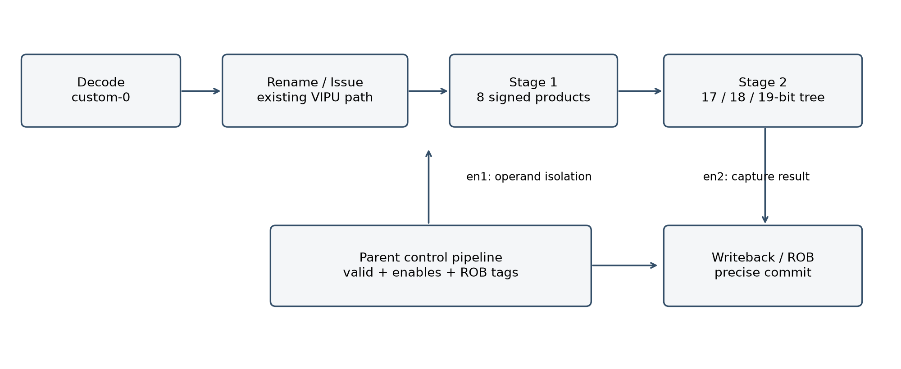

面向参赛者的结构、运行和答辩说明
2026 年 10 月 8 日

## 这个项目完成了什么

它给香山处理器增加一条自定义向量点积指令。程序发出编码后，香山读取两个向量寄存器，用新硬件计算结果，再经过已有写回和提交机制更新寄存器。NEMU 同时按相同语义执行，Difftest 比较两边的架构状态。

例如两个源的低 8 字节分别是 [0,1,2,3,4,5,6,7] 和 [2,2,2,2,2,2,2,2]，vdot 的结果是 56。结果存入目标寄存器低 32 位，高 96 位清零。它不是把 8 个乘积分别写回，而是归约成一个点积。



本机已在 KunminghuV2MinimalConfig 上完成整机差分测试。实测执行单元延迟 2 周期、独立发射间隔 1 周期、依赖链间隔 7 周期；256 元素 GEMV 行内核相对精度一致的 RVV 基线中位加速 1.116 倍。

作品名暂用 XSDot8 向量点积扩展。团队、作者、单位和 GitHub 账号留待你填写。低 32 位完整结果是本项目采用的工程语义，仍需留意官方后续澄清。

## 1 目录与核心文件

| 目录或文件 | 阅读目的 |
| --- | --- |
| README.md | 最快运行入口、实际验证状态和主要限制 |
| rtl/VDot.sv | 看懂 8 路乘法、扩位加法树、两级流水和使能 |
| integration/xiangshan.patch | 看指令如何进入香山已有译码、调度和写回通路 |
| integration/nemu.patch | 看参考模拟器如何计算相同结果与处理异常 |
| software/kernels.S | vdot 包装函数和标准 RVV 基线 |
| software/regression.c / regression_asm.S | 异常、寄存器、分支、依赖链、GEMV 测试 |
| results/system / results/waves | 原始运行日志、终端录像源、FST 与精简 VCD |
| docs / videos | 正式报告、中文说明与演示视频 |
| upstream-lock.json / SHA256SUMS.json | 锁定上游版本和交付文件校验 |

### MinimalConfig 在流程中的作用

它是生成 CPU 硬件时使用的配置类，不是程序精度开关，也不是 NEMU 的功能模式。较小的 ROB、缓存和队列让 RTL 构建更省资源，同时会改变目标程序的周期数。选择 Config → Chisel 生成 RTL → Verilator 编译 emu → 运行程序和 NEMU 对比，是正确的先后顺序。

MinimalConfig 用于环境起步；本作品进一步验证了 KunminghuV2MinimalConfig。完整昆明湖 V2 配置的资源更大，公开规则没有在本次查阅页面中明确指定唯一 Config 类名。因此报告只承诺已测的配置，不把它称为完整默认配置已经通过。

## 2 在当前电脑运行

打开 Ubuntu 22.04，进入独立工程。你原来的 xs-env 和上一版通过测试的 xsdot8-test 保留；新工程位于 ~/projects/xsdot8-award。

```bash
cd ~/projects/xsdot8-award/XSDot8
export XSDOT8_ROOT="$HOME/projects/xsdot8-award"
bash tools/run_existing.sh smoke
# 完整复测耗时较长
bash tools/run_existing.sh all
```

成功必须同时满足：进程退出码为 0；功能检查输出 PASS；仿真器输出 HIT GOOD TRAP；没有 Difftest mismatch。不能只看前面的 PASS 就提前宣布整机成功。

### 修改代码后怎么办

| 改动内容 | 需要重新执行 |
| --- | --- |
| C / 汇编测试程序 | 重新链接对应 AM 镜像，再运行差分 |
| RTL、Chisel、Config | 重新生成 RTL 和编译 emu，再做功能与波形回归 |
| NEMU 语义或 defconfig | 重建参考动态库，再做严格差分 |
| 指令规格 | 同步更新上述全部层级，重新验证报告数据 |

遇到内存不足，先检查 WSL 是否仍为 10 GB 内存和 D 盘 24 GB swap；编译命令使用 JVM_XMX=12G、-j4。不要同时启动多个香山 RTL 生成任务。已有 emu 的运行通常比重新生成 RTL 轻。

遇到首条指令失配，核对 boot ROM 和 NEMU 路径；遇到自定义指令非法，核对是否使用本包修改后的 emu 与 NEMU；遇到异常环境失配，检查 VS、NMIE、MDT 的初始化。保留第一处错误日志，比反复重装更有帮助。

## 3 怎样解释成果与准备提交

| 问题 | 可以准确回答的内容 |
| --- | --- |
| 为什么要 19 位求和 | 8×(-128)×(-128)=131072，超出 18 位有符号正数上限 |
| 为什么没有直接使用 vmul+vredsum | e8 运算可能先溢出；本项目用宽乘和宽归约保持相同精度 |
| 为什么单元 2 周期，依赖链却 7 周期 | 单元延迟和整机相关路径是不同指标，调度/写回/唤醒还会影响发射 |
| 是否证明大模型加速 | 只证明当前 dot8 与 GEMV 内核；没有完成整模型推理测试 |
| 是否测量功耗 | 测了同刺激下乘积输出翻转次数；没有物理功耗或面积数据 |
| 为什么会用到 NEMU | 它提供独立指令执行结果，与 RTL 的架构状态逐步核对 |

提交前由你填写团队、作者、单位、联系方式和 GitHub 仓库；查看官网最新通知，确认结果位宽等语义没有新要求。正式技术报告和项目说明可以直接编辑，但改动任何结果数字都应能对应到新日志。

本地包提供源码、设计、测试、波形、日志与真实执行回放视频。视频不伪装成首次安装的桌面录屏。若官方要求第一次安装全过程，应按文档在新环境复现并录制。公有仓库、加密提交信息和 PR 需按官方指南完成；当前没有自动对外提交。

建议先亲自跑 smoke，再阅读 VDot.sv 与 kernels.S，最后打开波形核对一次输入、输出和 ROB 提交。答辩时展示能解释的数据、遇到的问题和解决过程，比承诺未经验证的高倍数加速更有说服力。
